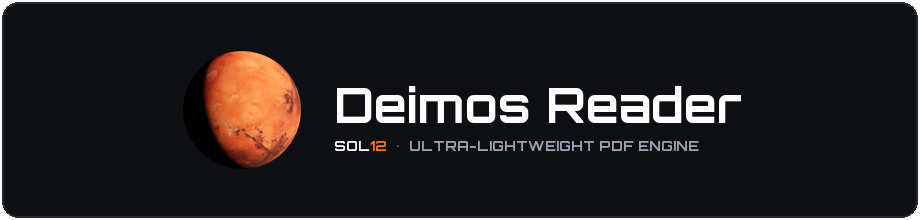
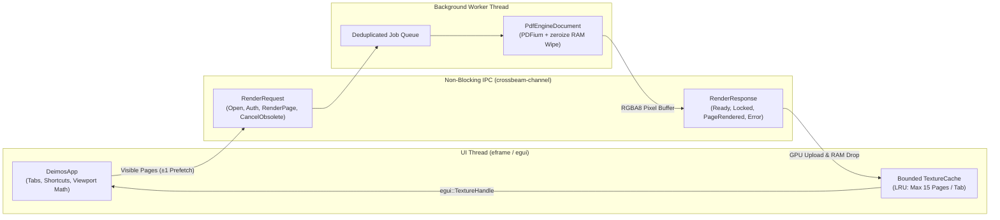

<div align="center">



[](https://github.com/SOL12-NET/DeimosReader/tree/main/releases)
[](Cargo.toml)
[](src/main.rs)
[](LICENSE)

**An ultra-lightweight, blazingly fast, and memory-safe Open Source desktop PDF reader engineered in Rust.**  
*Zero web engines • Zero telemetry • Zero bloat • Hardware-accelerated GPU rendering • Cryptographic RAM hygiene*

[⬇️ **Download Installer (.exe)**](https://github.com/SOL12-NET/DeimosReader/raw/main/releases/DeimosReader-Setup.exe) · [📦 **Download Portable (.zip)**](https://github.com/SOL12-NET/DeimosReader/raw/main/releases/DeimosReader-Portable-v0.6-Beta-win64.zip) · [📖 **Technical Architecture**](#-technical-architecture--engineering) · [🗺️ **Platform Roadmap**](#-platform-status--roadmap)

</div>

---

## 📦 Direct Downloads — Version 0.6 Beta (Windows x64)

Both the **Setup Installer** and the **Standalone Portable Edition** are available directly in the [`releases/`](releases/) directory of this repository for immediate installation:

| Edition | Download Link | Description |
| :--- | :--- | :--- |
| **Windows Installer** *(Recommended)* | [**`DeimosReader-Setup.exe`**](https://github.com/SOL12-NET/DeimosReader/raw/main/releases/DeimosReader-Setup.exe) | Full Windows setup wizard with the Mars application icon, Start Menu & Desktop shortcuts, automatic `.pdf` file association, and built-in uninstaller. |
| **Portable Edition** *(No Install Required)* | [**`DeimosReader-Portable-v0.6-Beta-win64.zip`**](https://github.com/SOL12-NET/DeimosReader/raw/main/releases/DeimosReader-Portable-v0.6-Beta-win64.zip) | Self-contained `.zip` archive containing `DeimosReader.exe`, `pdfium.dll`, and `LICENSE`. Extract anywhere (including a USB drive) and run immediately. |

---

## 🗺️ Platform Status & Roadmap

| Operating System | Status | Details |
| :--- | :--- | :--- |
| **Windows (x64)** | ✅ **Available (`v0.6 Beta`)** | Native Win32 / OpenGL hardware-accelerated build available in this repository (Installer & Portable). |
| **Linux (X11 / Wayland)** | 🚧 **In Active Development** | Being developed in a **dedicated Linux repository** with native X11/Wayland & XDG Desktop Portal integration. |
| **macOS** | 🗓️ **Upcoming** | Planned native build for Apple Silicon (`aarch64`) and Intel (`x86_64`). |
| **BSD (FreeBSD / OpenBSD)** | 🗓️ **Upcoming** | Planned native BSD desktop support. |

---

## ⚡ Philosophy & Strict YAGNI Scope

Modern PDF readers have grown into hundreds-of-megabytes suites bundling web browsers, JavaScript runtimes, cloud telemetry, and bloated editing toolbars. **Deimos Reader** takes the exact opposite engineering approach:

### What Deimos Reader Does
- **Instant Opening, High-FPS Virtual Scrolling & Precision Zoom**: Smoothly navigate documents from 1 to 10,000+ pages with `25%` to `400%` scaling (`5%` precision steps on `Ctrl + Mouse Wheel`) and a high-contrast SOL12 Orange (`#F97316`) vertical scrollbar.
- **Fluid Multi-Tab Workspace**: Open, switch, and compare multiple PDF documents simultaneously with Drag & Drop support.
- **Native Encrypted PDF Decryption**: Full support for password-protected PDFs (`RC4`, `AES-128`, `AES-256`) with automatic empty-password (`""`) unlocking for owner-restricted files and immediate RAM scrubbing via [`zeroize`](https://crates.io/crates/zeroize).
- **Signature SOL12 Software Visual Identity**: Dark-theme interface featuring the static high-resolution Mars emblem, **Orbitron Bold (700)** title typography, **`SOL12 Software`** (`Version 0.6 Beta`) branding, and a built-in Open Source **Licenses** viewer.

### What Deimos Reader Strictly Excludes
- **No WebView / Electron / Tauri**: 100% native GPU-rendered immediate-mode GUI (`eframe` / `egui`).
- **No Network Calls or Telemetry**: Completely offline by design; zero background connections.
- **No Feature Bloat**: No annotations, form filling, digital signatures, printing subsystems, or heavy bookmark trees.
- **No `unsafe` Application Code**: Enforced at compile time via `#![forbid(unsafe_code)]`.

---

## 🔧 Technical Architecture & Engineering



### 1. Tab State Machine (`src/tab.rs`)
Every open document tab (`TabId`) is governed by a deterministic state machine (`TabState`):
- **`Loading`**: The file is being parsed and inspected asynchronously by the background worker.
- **`Locked { retry_count, error_msg }`**: The document requires a user password. Displays a centered unlock card with an auto-focused masked password field.
- **`Ready { page_count, page_dimensions }`**: Document metadata and page dimensions `(width_pts, height_pts)` are pre-calculated for instant virtual layout.
- **`Error(String)`**: Cleanly reports corrupted or unreadable files without crashing the application.

### 2. Cryptographic Password Hygiene (`src/pdf_engine.rs` & `src/tab.rs`)
1. When opening a PDF, the engine immediately checks whether encryption is present (`needs_password()`).
2. If encrypted, the engine first **automatically tests the empty password `""`**—seamlessly opening PDFs that have an owner password restricting permissions but an empty user password.
3. If a user password is required, the password typed in the UI is extracted into a `zeroize::Zeroizing<String>` container while the UI buffer is immediately wiped in RAM via `.zeroize()`.
4. As soon as `authenticate_password()` completes inside the PDF engine, both the password string and the raw encrypted document byte buffer are overwritten with zeros in memory via `.zeroize()`.

### 3. Asynchronous Rendering Pipeline & Strict VRAM/RAM Budget (`src/worker.rs` & `src/cache.rs`)
- **Zero UI Blocking**: The main thread never performs PDF parsing or page rasterization.
- **Viewport Visibility Calculation**: During vertical scrolling (`egui::ScrollArea::show_viewport`), `Tab::compute_visible_pages` computes the exact range of pages intersecting the screen using pre-calculated page dimensions and the active zoom factor.
- **On-Demand Pre-Fetching**: Only currently visible pages ($\pm 1$ adjacent page above and below) are requested from the worker thread.
- **Instant Obsolescence Cancellation**: Changing zoom levels, scrolling rapidly, or closing a tab immediately purges outdated queued jobs in the worker before rasterization begins.
- **15-Page Per-Tab LRU Eviction**: `TextureCache` wraps `lru::LruCache` with a hard cap of **15 pages per tab**. When a 16th page is cached or a tab is closed, the evicted `egui::TextureHandle` is dropped immediately, freeing both GPU VRAM and system RAM.

### 4. Source Tree Layout
```text
├── Cargo.toml                 # Dependencies & fat-LTO Release profile
├── build.rs                   # Embeds high-res Mars icon & version info into Windows PE
├── LICENSE                    # MIT License
├── README.md                  # Project documentation
├── assets/
│   ├── deimos_reader_banner.png # Project header banner (Mars logo + Orbitron Bold)
│   ├── Orbitron-Bold.ttf        # Orbitron Bold (700) title font
│   ├── mars_logo.png            # High-resolution static Mars logo (256x256)
│   └── mars_icon.ico            # Multi-resolution Windows icon (16x16 to 256x256)
├── installer/
│   └── deimos_reader.iss      # Inno Setup script for DeimosReader-Setup.exe
├── releases/                  # Prebuilt Windows Installer (.exe) & Portable (.zip)
└── src/
    ├── main.rs                # Entry point, window icon & Windows console suppression
    ├── app.rs                 # Global UI state, tab bar, licenses modal, shortcuts
    ├── tab.rs                 # Tab state machine & viewport visibility math
    ├── pdf_engine.rs          # Isolated PDF engine wrapper (open, auth, RGBA8 render)
    ├── worker.rs              # Background rendering thread & queue deduplication
    └── cache.rs               # Bounded LRU GPU texture cache (max 15 pages/tab)
```

---

## ⌨️ Keyboard Shortcuts & Controls

| Shortcut / Action | Description |
| :--- | :--- |
| `Ctrl + O` | Open one or more PDF files |
| `Ctrl + W` / Middle-Click on Tab | Close the active or clicked tab |
| `Ctrl + Tab` / `Ctrl + Shift + Tab` | Cycle to the next / previous tab |
| `Ctrl + Mouse Wheel` | Fine precision zoom in / out in **`5%` steps** (`25%` to `400%`) |
| `Ctrl + '+'` / `Ctrl + '-'` | Standard zoom in / out in **`25%` steps** (`25%` to `400%`) |
| `Ctrl + 0` | Reset zoom level to `100%` |
| Drag & Drop | Drop `.pdf` files anywhere into the window to open them in new tabs |

---

## 🛠️ Building from Source (Windows)

### Prerequisites
1. **Rust Toolchain** (`1.80+`, Edition 2021) via [rustup.rs](https://rustup.rs/) (`x86_64-pc-windows-msvc` or `x86_64-pc-windows-gnu`).
2. **PDFium Dynamic Library (`pdfium.dll`)** placed at the repository root (included in [`releases/DeimosReader-Portable-v0.6-Beta-win64.zip`](releases/DeimosReader-Portable-v0.6-Beta-win64.zip) or downloadable from [`bblanchon/pdfium-binaries`](https://github.com/bblanchon/pdfium-binaries/releases)).

### Build & Test Commands
```powershell
# Run strict Clippy static analysis (0 warnings allowed)
cargo clippy --all-targets -- -D warnings

# Run unit test suite (state machine, encryption, zeroize, LRU eviction, worker pipeline)
cargo test

# Build size- and speed-optimized Release binary (fat LTO, stripped symbols, panic=abort)
cargo build --release
```

The `[profile.release]` configuration in [`Cargo.toml`](Cargo.toml) enforces:
```toml
[profile.release]
opt-level = 3
lto = "fat"
codegen-units = 1
panic = "abort"
strip = "symbols"
```

---

## 📜 License & Open Source Attributions

**Deimos Reader** is released under the **[MIT License](LICENSE)** (`Copyright (c) 2026 SOL12.NET`).

 All third-party open-source licenses and attributions can be inspected directly inside the application via the **Licenses** button in the bottom-right corner of the welcome screen:
- **PDFium** — BSD 3-Clause / Apache-2.0 (`Google LLC / The Chromium Authors`)
- **pdfium-render** — MIT / Apache-2.0 (`Alastair Carey`)
- **egui & eframe** — MIT / Apache-2.0 (`Emil Ernerfeldt & Rerun Technologies AB`)
- **rfd (Rusty File Dialog)** — MIT (`PolyMeilex`)
- **crossbeam-channel** — MIT / Apache-2.0 (`The Crossbeam Project Developers`)
- **zeroize** — MIT / Apache-2.0 (`The RustCrypto Project Developers`)
- **lru** — MIT (`Jerome Froelich`)
- **png** — MIT / Apache-2.0 (`The image-rs Developers`)
- **Orbitron Typeface** — SIL Open Font License 1.1 (`Matt McInerney`)
- **Mars Surface Texture** — Creative Commons Attribution 4.0 (`Solar System Scope / NASA`)
